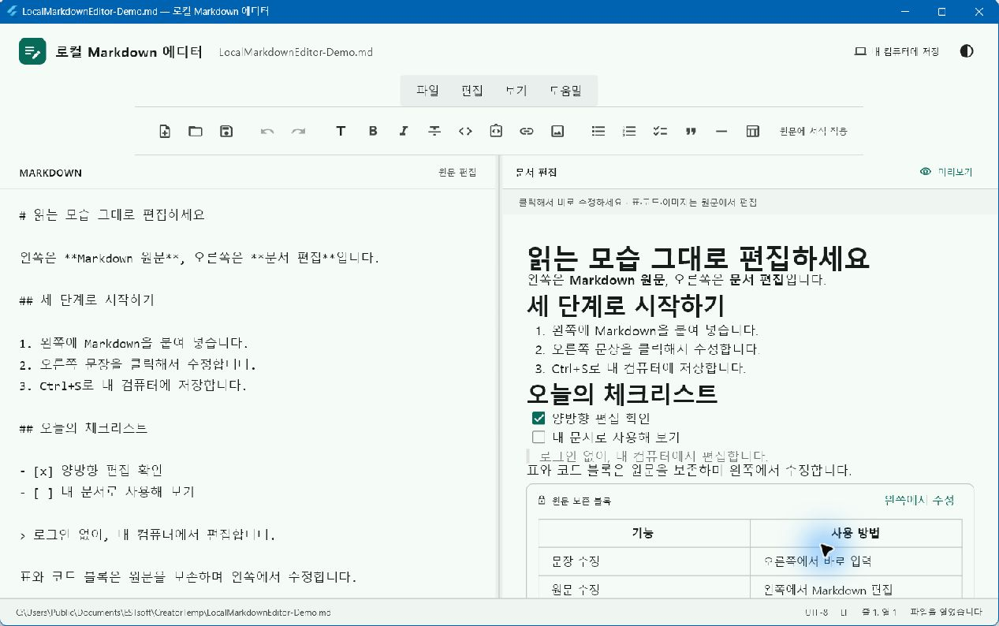
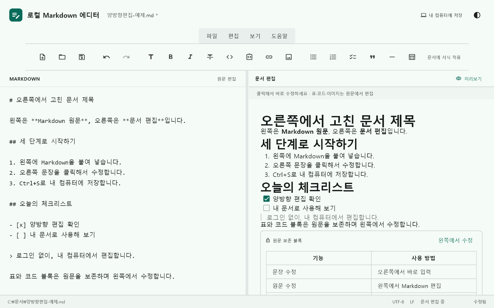
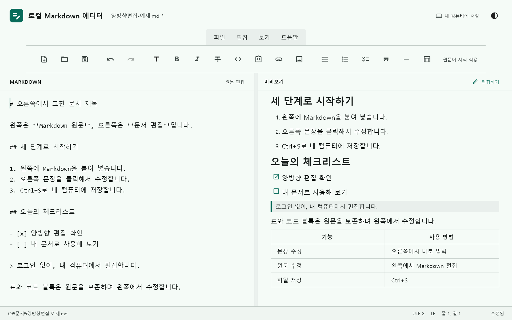
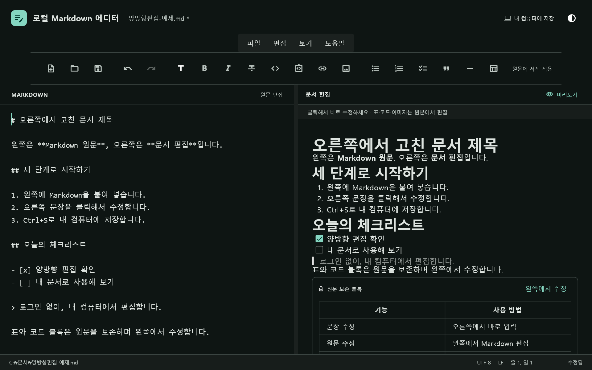

# 로컬 Markdown 에디터

**Markdown을 붙여 넣고, 읽는 모습 그대로 고치세요.** 왼쪽 원문과 오른쪽 문서를 양방향으로 편집하는 무료 Windows 앱입니다. 결과물은 내 컴퓨터의 일반 `.md` 파일로 저장됩니다.

[**Windows 설치 파일 다운로드 · v1.1.0**](https://github.com/Kay-lucas/local-markdown-editor/releases/download/v1.1.0/LocalMarkdownEditor-Setup-1.1.0-x64.exe) · [모든 배포 파일](https://github.com/Kay-lucas/local-markdown-editor/releases/latest) · [MIT 라이선스](LICENSE)

로그인·서버·DB·AI API·구독 없이 사용할 수 있습니다. 편집과 저장에는 인터넷이 필요하지 않습니다. 현재 배포본은 **Windows x64 전용**입니다.



## 1. 설치하고 바로 사용하기

1. 위 **Windows 설치 파일 다운로드**를 누릅니다. GitHub 계정 없이 받을 수 있습니다.
2. `LocalMarkdownEditor-Setup-1.1.0-x64.exe`를 실행합니다.
3. **다음 → 설치 → 마침**을 누르고 시작 메뉴의 **로컬 Markdown 에디터**를 실행합니다.
4. 왼쪽에 Markdown을 붙여 넣거나 **열기 / Ctrl+O**로 기존 문서를 엽니다.

Flutter·개발 도구·별도 런타임 다운로드는 필요하지 않습니다. 필요한 Microsoft Visual C++ x64 실행 구성 요소를 설치 파일에 포함했습니다. 기본 위치는 `%LOCALAPPDATA%/Programs/LocalMarkdownEditor`이며 현재 사용자 계정에 설치합니다. 관리자 권한은 요구하지 않습니다.

기존 버전이 있다면 **열어 둔 문서를 저장하고 앱을 종료한 뒤** 새 설치 파일을 실행하세요. Markdown·예제 문서를 덮어쓰지 않으며, 제거할 때도 사용자 문서는 보존합니다. 자동 업데이트는 포함하지 않습니다.

현재 배포자 코드 서명은 없습니다. Windows·브라우저에서 평판 경고가 나타날 수 있습니다. [Microsoft의 SmartScreen 안내](https://learn.microsoft.com/en-us/windows/security/operating-system-security/virus-and-threat-protection/microsoft-defender-smartscreen/)를 참고하세요.

소스 ZIP과 GitHub의 **Code → Download ZIP**은 개발용 소스입니다. 일반 사용자는 **Setup으로 끝나는 exe 설치 파일**을 선택하면 됩니다.

## 2. 새 기능: 양쪽에서 편집하기

### 왼쪽에 붙여 넣으면 오른쪽에 문서가 나옵니다

왼쪽 **MARKDOWN**은 기호를 직접 다루는 원문 편집기입니다. `# 제목`, `**굵은 글씨**`, 목록 같은 Markdown을 넣으면 약 200ms 입력 대기 후 오른쪽에 반영됩니다. 문서 내용을 AI로 바꾸거나 번역하는 기능은 아닙니다.

### 오른쪽 문장을 고치면 왼쪽 원문도 바뀝니다

오른쪽 **문서 편집**을 클릭해 문장을 수정하세요. 예를 들어 오른쪽의 제목을 ‘주간 회의록’으로 바꾸면 왼쪽도 `# 주간 회의록`으로 바뀝니다. 새 문단을 입력하거나 내용을 지울 수도 있습니다.



### 서식 버튼은 마지막으로 편집한 쪽에 적용됩니다

왼쪽 또는 오른쪽에서 텍스트를 선택하고 **굵게·기울임·제목·목록·인용·링크** 버튼을 누릅니다. 툴바의 ‘원문에 서식 적용 / 문서에 서식 적용’ 안내로 적용 대상을 확인할 수 있습니다. Ctrl+B와 Ctrl+I도 사용할 수 있습니다.

실행 취소는 두 칸이 하나의 기록을 공유합니다. 오른쪽을 수정한 뒤 **Ctrl+Z**를 누르면 왼쪽 원문도 함께 복원되고, **Ctrl+Y / Ctrl+Shift+Z**로 다시 적용됩니다.

### 표·코드·이미지는 원문을 보존합니다

| 문서 내용 | 오른쪽에서 가능한 작업 |
| --- | --- |
| 본문·제목·굵게·기울임·취소선·인라인 코드 | 직접 입력·선택·서식 수정 |
| 단순 목록·체크리스트·인용문·링크 | 문구·서식 수정, 체크 상태 변경 |
| 표·코드 블록·이미지·구분선·복잡한 구문 | **원문 보존 블록**으로 표시. 내부 수정은 왼쪽에서 진행 |

원문 보존 블록은 내부 내용을 자동으로 재작성하지 않습니다. 주변 문장을 고쳐도 원래 표 정렬·코드·이미지 경로를 유지합니다. 블록 전체를 선택해서 삭제하는 것은 가능하며, 이때는 해당 원문도 삭제됩니다.

수정하지 않은 블록은 `__굵게__` 같은 원래 표현과 빈 줄을 유지합니다. **수정한 블록은 Markdown 표현이 정리될 수 있습니다.** 예를 들어 `__내용__`이 `**내용**`으로, 줄을 나누어 작성한 일반 문단이 한 소스 줄로 바뀔 수 있습니다. [상세 지원 범위와 보존 규칙](docs/bidirectional-editing.md)

외부 앱에서 오른쪽으로 붙여 넣으면 텍스트로 입력합니다. Markdown 기호를 해석하려면 왼쪽에 붙여 넣으세요. 워드·웹페이지의 HTML 서식을 자동으로 가져오지는 않습니다.

## 3. 미리보기·다크 모드·파일 저장

오른쪽 위 **미리보기**를 누르면 기존 읽기 전용 GFM 보기로 전환합니다. **편집하기**를 누르면 다시 문서 편집으로 돌아옵니다. 표, 중첩 목록, 코드, 로컬 이미지 등을 확인할 때 사용할 수 있습니다.



오른쪽 위 테마 버튼 또는 **보기** 메뉴에서 **시스템 / 라이트 / 다크**를 선택합니다. 가운데 분할선을 끌어 두 칸의 폭을 바꿀 수 있습니다. 테마와 분할 비율은 다음 실행에도 유지됩니다.



- **저장 / Ctrl+S**: 현재 파일에 저장합니다. 새 문서는 저장할 위치를 선택합니다.
- **다른 이름으로 저장 / Ctrl+Shift+S**: 새 경로에 저장하고 그 파일을 계속 편집합니다.
- 파일명 옆 `*`와 아래 **수정됨**은 아직 저장하지 않은 변경입니다.
- 문서를 바꾸거나 정상 종료할 때 변경이 있으면 **저장 / 버리기 / 취소**를 묻습니다.
- 파일이 다른 앱에서 수정되었다면 충돌을 안내합니다. 자동으로 병합하지 않습니다.

앱은 UTF-8 한글·이모지를 지원하며 기존 BOM과 LF/CRLF를 유지합니다. 같은 폴더에 임시 파일을 완전히 쓴 뒤 원본을 교체합니다. 저장에 실패하면 편집 내용과 원본을 보존하고 오류를 안내합니다. 전원 차단·강제 종료를 대비한 자동 저장이나 복구는 제공하지 않습니다.

시작 메뉴의 **예제 문서** 또는 저장소의 [양방향 편집 예제](test/fixtures/bidirectional-demo.md)를 열어볼 수 있습니다. 첫 이미지는 실제 Windows 실행 창을 캡처했습니다. 나머지 세 이미지는 동일한 Flutter 앱 화면을 자동 입력·렌더링한 캡처입니다. 재현 도구는 `tool/capture_screenshots_test.dart`입니다.

## 4. 단축키

| 키 | 동작 |
| --- | --- |
| Ctrl+N / Ctrl+O | 새 문서 / 파일 열기 |
| Ctrl+S / Ctrl+Shift+S | 저장 / 다른 이름으로 저장 |
| Ctrl+B / Ctrl+I | 굵게 / 기울임 |
| Ctrl+K | 링크 삽입 |
| Ctrl+Z | 양쪽 편집의 실행 취소 |
| Ctrl+Y / Ctrl+Shift+Z | 다시 실행 |
| Ctrl+X / C / V / A | 잘라내기 / 복사 / 붙여넣기 / 전체 선택 |
| Tab | 원문: 스페이스 2칸 / 문서 편집: 목록 들여쓰기 등 |
| Alt+F4 | 종료 및 미저장 확인 |
| Esc | 대화상자 취소 |

서식·실행 취소는 편집 영역에 적용됩니다. 링크 입력 창에서는 해당 입력 필드의 기본 동작을 사용합니다. 한글 조합 중에는 서식 변경을 보류합니다.

## 5. 내 문서와 오프라인 동작

- 본문은 선택한 로컬 `.md`·`.markdown` 파일에만 저장합니다. 로그인·계정·클라우드 동기화·분석 수집 기능은 없습니다.
- 로컬 이미지는 문서 폴더 기준 상대 경로나 로컬 절대 경로로 표시합니다. 다른 폴더에 저장하면 기준도 바뀌며 이미지를 자동 복사하지 않습니다.
- PNG·JPEG·GIF·WebP를 지원합니다. 원격 이미지·UNC·네트워크 드라이브는 차단하며 SVG는 렌더링하지 않습니다.
- HTTP(S) 링크는 사용자가 여는 동작을 했을 때만 외부 브라우저로 연결합니다. 자동 이미지 다운로드나 페이지 요청은 없습니다.
- 원시 HTML은 문자로 표시하며 실행하지 않습니다. 수식·Mermaid 렌더링은 포함하지 않습니다.
- 로컬 `settings.json`에는 테마와 분할 비율만 보관합니다. 본문·최근 파일·계정 데이터는 넣지 않습니다.
- 개발용 패키지를 처음 준비할 때 필요한 다운로드는 앱의 오프라인 사용과 별개입니다.

## 6. 개발 환경

이번 구현에 사용한 환경입니다. Flutter를 임의로 업그레이드하지 않고 설치된 stable SDK로 검증했습니다.

| 도구 | 사용 버전 |
| --- | --- |
| Windows | Windows 11 Home 26H2, Build 26300, x64 |
| Flutter | stable 3.44.4 |
| Dart | 3.12.2 |
| Visual Studio | Build Tools 2026 18.6.0 |
| Windows SDK | 10.0.26100.0 |
| Git | 2.55.0.windows.3 |

Flutter SDK와 Visual Studio의 **C++를 사용한 데스크톱 개발** 도구가 필요합니다. VS Code만 설치한 경우 C++ 빌드 도구가 별도로 필요합니다. Android 관련 doctor 경고는 이 Windows 전용 앱에 영향을 주지 않습니다.

Windows C++ 도구의 경로 길이 제한을 피하려면 소스 압축을 `C:/dev/local_markdown_editor`처럼 짧은 경로에 푸는 것을 권장합니다. 생성된 `build` 폴더는 다른 경로로 재사용하지 말고 해당 위치에서 새로 빌드하세요.

### 일반 명령

앱 루트에서 실행합니다.

```powershell
flutter doctor -v
flutter devices
flutter pub get
dart format lib test tool
flutter analyze
flutter test
flutter run -d windows
flutter build windows --release
```

### 설치된 Flutter 배치 실행기가 작동하지 않을 때

이 프로젝트에는 설치된 SDK 안의 Dart와 Flutter 도구를 직접 실행하는 보조 명령이 있습니다. SDK 파일과 Windows 설정을 바꾸지 않습니다. Flutter의 `bin`이 PATH에 등록되어 있어야 합니다.

```powershell
.\tool\flutter.ps1 doctor -v
.\tool\flutter.ps1 pub get
.\tool\flutter.ps1 analyze
.\tool\flutter.ps1 test
.\tool\flutter.ps1 run -d windows
.\tool\flutter.ps1 build windows --release
```

개발자 모드가 꺼져 플러그인 연결 오류가 나는 경우, 보조 `pub get` 명령은 프로젝트 안의 디렉터리 연결을 준비한 뒤 재시도합니다. 일반 명령을 사용 중이라면 아래 순서로 같은 준비를 할 수 있습니다.

```powershell
.\tool\prepare_windows_plugins.ps1
flutter pub get
```

`windows/flutter/CMakeLists.txt`의 빌드 단계는 `tool/windows_backend.dart`를 사용합니다. Flutter가 생성한 표준 환경 변수를 그대로 받아 SDK의 도구 snapshot을 직접 호출하므로 이 컴퓨터의 배치 실행기 문제를 우회합니다. 현재 앱의 일반 Debug·Release 빌드 범위를 지원하며, 커스텀 엔진·난독화·분리 디버그 심볼은 이 앱의 범위가 아닙니다.

빌드 결과 기본 위치는 `build/windows/x64/runner/Release`입니다. 전체 폴더를 함께 배포합니다.

### 설치 파일 제작

NSIS 3.13 공식 Windows ZIP을 내려받아 압축을 풉니다. 별도의 NSIS 설치는 필요하지 않습니다. 공식 배포 파일의 SHA-256은 `THIRD_PARTY_NOTICES.md`에 기록했습니다. VS Build Tools의 x64 **release** CRT 경로를 지정합니다.

```powershell
.\tool\build_installer.ps1 `
  -NsisCompiler C:\tools\nsis-3.13\makensis.exe `
  -PayloadDirectory C:\release\LocalMarkdownEditor-Windows-x64 `
  -OutputDirectory C:\release `
  -MsvcRuntimeDirectory 'C:\Program Files (x86)\Microsoft Visual Studio\18\BuildTools\VC\Redist\MSVC\14.51.36231\x64\Microsoft.VC145.CRT'
```

`installer/windows.nsi`가 사용자별 설치와 제거를 정의하고, 제작 스크립트가 정확한 앱 파일 목록을 생성합니다. 제거할 때 설치 폴더 전체를 재귀 삭제하지 않습니다. Markdown·예제 문서는 제거 목록에서 제외하며, 기존 문서가 있는 관련 없는 폴더에는 설치하지 않습니다. 새 버전 설치 파일을 만들 때는 앱과 함께 제공하는 런타임도 갱신해야 합니다.

`tool/test_installer.ps1`은 기존 앱 설치가 없는 경우에만 새 검증 폴더에서 설치·재설치·제거·사용자 문서 보존을 검사합니다. 사용자 계정의 앱 설치 기록과 시작 메뉴를 잠시 만들었다가 검증 후 제거하므로, 실제 설치가 이미 있다면 실행하지 않습니다.

## 7. 구조와 검증

| 경로 | 역할 |
| --- | --- |
| `lib/models` | 인코딩·BOM·줄바꿈 |
| `lib/controllers` | 문서 상태, 편집 이력, 저장·전환 제어 |
| `lib/commands` | 선택 영역에 적용하는 순수 서식 변환 |
| `lib/services` | 파일 IO, 대화상자, 로컬 경로 정책, 설정, 창 제어, 링크 실행 |
| `lib/widgets` | 원문·문서 편집 화면, 원문 보존 블록, GFM 미리보기 |
| `test` | 단위·위젯 테스트, 예제 Markdown과 이미지 |
| `tool` | Windows 빌드 보조 명령과 AOT 성능 측정 |

v1.1의 자동 테스트·빌드·설치 결과와 캡처 방식은 [최신 검증 기록](verification/v1.1.0.md)에, v1.0 초기 검증 기록은 [verification.md](verification.md)에 구분해 기록합니다. 도구나 자동 테스트만으로 실제 한글 IME·네이티브 대화상자를 검증했다고 표현하지 않습니다.

성능 보조 측정은 다음과 같습니다. Flutter 화면 전체의 입력 지연 측정과는 구분합니다.

```powershell
dart compile exe tool/benchmark.dart -o benchmark.exe
.\benchmark.exe
```

## 8. 의존성과 라이선스

실제 해석 버전은 `pubspec.lock`을 기준으로 합니다. 최신 버전이 있다는 이유만으로 자동 업그레이드하지 않습니다.

| 직접 의존성 | 버전 | 용도 |
| --- | --- | --- |
| flutter_markdown_plus | 1.0.12 | Flutter 위젯 미리보기 |
| markdown | 7.3.1 | GFM 파싱 |
| file_selector | 1.1.0 | 네이티브 파일 선택 |
| window_manager | 0.5.2 | 창 크기·제목·정상 종료 제어 |
| path_provider_windows | 2.3.0 | Windows 앱 전용 설정 경로 |
| url_launcher | 6.3.3 | 명시적으로 클릭한 웹 링크 열기 |
| path | 1.9.1 | 파일 경로 처리 |
| characters | 1.4.1 | 한글·이모지의 표시 문자 경계 |
| ffi | 2.2.0 | 매핑된 네트워크 드라이브 식별 |

앱의 **도움말 → 오픈소스 라이선스**에서 Flutter에 포함된 고지문을 확인할 수 있습니다. 배포할 때 `data/flutter_assets/NOTICES.Z` 등 빌드가 생성한 라이선스 파일도 함께 유지하세요.

공식 참고: [Flutter Windows 설정](https://docs.flutter.dev/platform-integration/windows/setup), [Flutter 테스트](https://docs.flutter.dev/cookbook/testing), [GFM 사양](https://github.github.com/gfm/), [Flutter Markdown Plus](https://pub.dev/packages/flutter_markdown_plus), [파일 선택](https://pub.dev/packages/file_selector), [창 제어](https://pub.dev/packages/window_manager).

## 9. Git과 다음 범위

GitHub 저장소: [Kay-lucas/local-markdown-editor](https://github.com/Kay-lucas/local-markdown-editor)

소스·테스트·문서·잠금 파일은 Git으로 관리하고 빌드·캐시·임시 파일은 제외합니다. 설치 파일과 Windows 실행 파일 ZIP·소스 ZIP은 [Releases](https://github.com/Kay-lucas/local-markdown-editor/releases)에서 제공합니다. 이 저장소는 공개 저장소이며, 앱 다운로드에 GitHub 로그인이 필요하지 않습니다.

### MIT 라이선스

이 프로젝트의 자체 작성 앱 코드와 설치 스크립트는 [MIT 라이선스](LICENSE)로 공개합니다. 개인·업무·상업적 사용, 수정과 재배포를 허용합니다. 복사하거나 재배포할 때 저작권 표시와 라이선스 고지를 유지해야 합니다.

Flutter·패키지·Microsoft 런타임 등 외부 구성 요소에는 각각의 라이선스가 적용됩니다. [THIRD_PARTY_NOTICES.md](THIRD_PARTY_NOTICES.md)와 앱에 포함된 고지문도 함께 유지하세요.

LinkedIn 등에는 [설치 파일이 있는 릴리스 페이지](https://github.com/Kay-lucas/local-markdown-editor/releases/latest)를 공유하면 됩니다.

다중 탭, 자동 저장, 최근 파일, 문법 색상 강조, 스크롤 동기화, 찾기·바꾸기, PDF·HTML 내보내기는 이번 버전 범위에 포함하지 않습니다. 설치 파일은 이후 배포 편의 요청으로 추가한 산출물입니다. 원래 요구사항의 설치 프로그램 제외 항목보다 이 후속 요청을 우선합니다.
